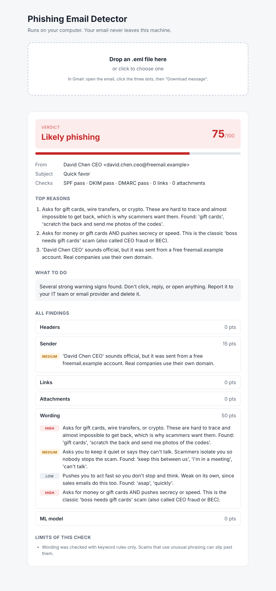
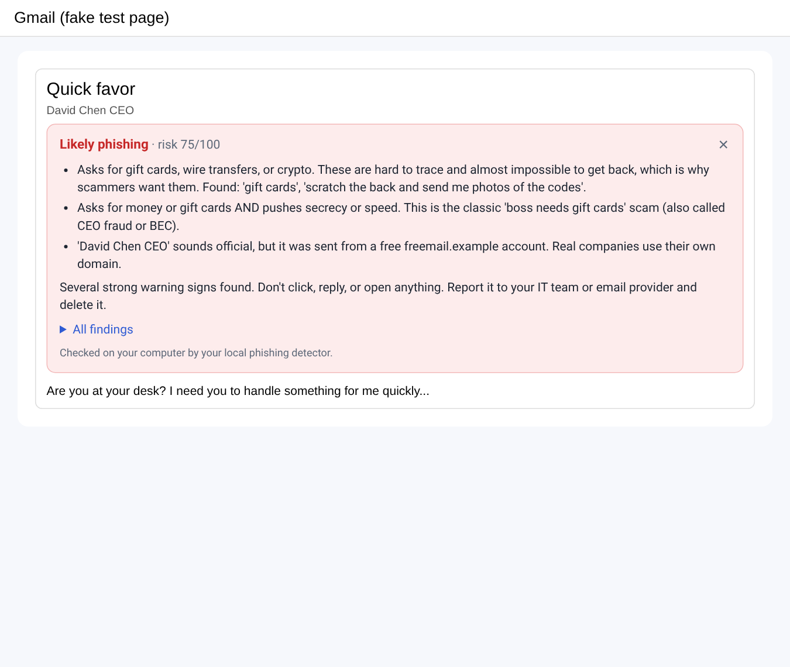

# AI Phishing Email Detector

A phishing email detector written in Python. Give it a raw email file (`.eml`) and it tells you how risky the email is and why.

It runs fully offline. No paid APIs, no cloud AI, and no email text ever leaves your machine. The core tool uses only Python's standard library.

```
============================================================
VERDICT: LIKELY PHISHING
Risk score: 75/100  [###############-----]
============================================================
Subject: Quick favor
From:    David Chen CEO <david.chen.ceo@freemail.example>

Top reasons:
  1. Asks for gift cards, wire transfers, or crypto. Found: 'gift cards',
     'scratch the back and send me photos of the codes'.
  2. Asks for money or gift cards AND pushes secrecy or speed. This is the
     classic 'boss needs gift cards' scam (also called CEO fraud or BEC).
  3. 'David Chen CEO' sounds official, but it was sent from a free email account.

What to do: Several strong warning signs found. Don't click, reply, or open
anything. Report it to your IT team or email provider and delete it.
```

That email passes SPF, DKIM, and DMARC, and it has no links or attachments. A header-only checker would call it clean. This tool catches it by combining several separate checks.

## What it checks

| Check | What it catches |
|---|---|
| **Headers** | SPF, DKIM, and DMARC results. Reply-To and Return-Path that don't match the sender. Only trusts the top `Authentication-Results` header, because lower ones can be forged. |
| **Sender** | Lookalike domains (`paypa1.com`, `rnicrosoft.com`), typo-squats (`amazom.com`), brand names stuffed into fake domains, punycode domains, display names that claim a brand or hide a fake address, "official" names sent from free email accounts. |
| **Links** | Link text that shows one site but goes to another, raw IP links, the `@` trick (`paypal.com@evil.com`), brands used as fake subdomains (`paypal.com.evil.com`), `javascript:` links, URL shorteners. Links are never opened. |
| **Attachments** | Dangerous file types, double extensions (`invoice.pdf.exe`), the right-to-left text trick, macro-enabled Office files, HTML attachments, files whose bytes don't match their name, and zip archives: programs hidden inside, password-protected zips, zips inside zips. Files are never opened or unzipped. |
| **Wording** | Scam tactics: gift card and wire requests, password requests, threats, secrecy, "new bank details," prizes, urgency. Also catches combos like money plus secrecy (CEO fraud). |
| **ML model** | A text classifier I trained on 17,500 labeled emails (experimental, see below). |

Each check reports findings with a severity. Only the scoring step gives a verdict.

## How the score works

- Each finding is worth points: high 30, medium 15, low 5.
- Each category is capped at 50, so a pile of small warnings in one area can't create a scary score by itself.
- If two or more categories find real problems, it adds 10 points. Separate checks agreeing is strong evidence.
- Passing a check never lowers the score. Scammers can set up DMARC on their own domains, so a pass proves very little.
- **0 to 19:** Low risk. **20 to 49:** Suspicious. **50+:** Likely phishing.

The wording is careful on purpose: "Likely phishing," never "confirmed." Every report also lists what the tool could *not* check.

## Quick start

Requires Python 3.10 or newer. Nothing to install.

```bash
git clone https://github.com/jd24610/ai-phishing-email-detector.git
cd ai-phishing-email-detector

python3 main.py samples/sample_ceo_fraud.eml
python3 main.py samples/sample_phish.eml --details   # also shows the parsed email

python3 -m unittest discover tests                    # 101 tests
```

### Web page

```bash
python3 server.py
```

Then open **http://127.0.0.1:8765** and drop an `.eml` file on the page. It shows the verdict, top reasons, every finding by category, and the limits of the check.



### Chrome extension (scans Gmail automatically)

When you open an email in Gmail, the extension grabs its raw source (the same thing Gmail's "Show original" shows), sends it to the detector running on your computer, and puts a banner above the message.



1. Start the detector: `python3 server.py` (leave it running)
2. In Chrome, go to `chrome://extensions` and turn on **Developer mode** (top right)
3. Click **Load unpacked** and pick the `extension` folder
4. Open Gmail and open any email

Click the shield icon in the toolbar to see if the detector is running or to turn auto-scan off.

How it stays private and safe:
- Emails only go to `127.0.0.1`. Nothing is sent online.
- The extension can only touch `mail.google.com` and `127.0.0.1:8765`.
- Its ID is fixed (`amibjogglnglgnopfajdejkgeolfnljd`) by a public key in the manifest, and the server only accepts this extension. Websites and other extensions are refused.
- The banner sits in a closed shadow root and shows email text with `textContent` only, so a scam email can't inject code into it or change what it says.
- Each email is scanned once per page load.

Heads up: Gmail has no official API for extensions to read an open email. The extension relies on Gmail's page layout (`data-legacy-message-id`, `.a3s`), its account key (`ik`), and its "Show original" URL. Checked on real Gmail in November 2026: Show original returns 404 without `ik`, Gmail enforces Trusted Types (so `DOMParser` is not used), and Google emails can have 6,000+ characters of headers before `From:`. The fake Gmail in `dev/e2e_extension.py` copies all three. If Google changes those, `extension/gmail.js` is the one file to update. Very large emails may be cut off in Gmail's "Show original" view.

To check a real email by hand: in Gmail, open the message, click the three dots, then **Download message**. Run the tool on that `.eml` file. Keep real emails in `private_samples/` (it's git-ignored).

## The ML model (and what went wrong with it)

`ml/train_model.py` trains a TF-IDF + logistic regression classifier on a public dataset of 18,650 emails (17,522 after removing empty and duplicate rows). Train/test split is 80/20, done before training.

| Model | Accuracy | Phishing precision | Phishing recall |
|---|---|---|---|
| Naive Bayes | 97.4% | 0.983 | 0.947 |
| **Logistic Regression** | **98.5%** | **0.981** | **0.978** |

Those numbers look great, but two problems showed up:

1. **Shortcut learning.** The first model learned that "enron," "houston," and "2001" meant *safe* and "2005" meant *phishing*. That reflects where the emails came from, not what phishing looks like. I switched to letters-only tokens and removed dataset-specific words. Accuracy barely moved (98.7% to 98.5%), which shows the shortcuts weren't doing real work.
2. **Dataset shift.** On modern emails the model struggles. It rated a normal "your order has shipped" email 95% phishing and a plain CEO gift card scam only 46%. The "safe" training emails were internal office chatter, so any company writing to a customer looks suspicious to it.

Because of this, the model is marked **experimental**. Its strongest output is a "low" finding (5 points), and it can never decide a verdict on its own. Retraining on modern data is on the roadmap.

The model is exported to JSON and run with a ~15-line pure-Python predictor. A test checks that it matches scikit-learn's output on 200 emails.

To retrain:
```bash
pip install -r requirements-dev.txt
# put Phishing_Email.csv in data/
python3 ml/train_model.py
```

## Security design

- **Links are never visited.** Everything is done by reading the URL as text. Links in output are defanged (`hxxps://bad[.]com`).
- **Attachments are never saved, opened, or run.** Only the name, claimed type, SHA-256 hash, and first 8 bytes are kept.
- **Zips are never decompressed.** Only the table of contents is read, so zip bombs can't hurt it. Max 500 entries.
- **No pickle.** Loading a pickle file can run code, so the model is stored as plain JSON with a size limit and field checks.
- **Input limits.** 10 MB max email, 100 links max, 50k characters of text scanned.
- **Minimal logging.** Email bodies are only previewed (200 characters), never dumped.
- **The local server is locked down.** It only listens on `127.0.0.1`, checks the `Host` header to block DNS rebinding, only accepts requests from its own page (and later, our own extension ID), never logs email content, and sends a strict Content Security Policy.
- **No XSS from email content.** The page inserts every piece of email text with `textContent`, never `innerHTML`. A test email with `<script>` in its subject shows up as plain text.
- **Test samples are safe.** They use reserved `.example` domains and `203.0.113.x` IPs, and the "malware" is harmless text.

## Project structure

```
main.py                  Command-line tool: verdict, findings, limits
server.py                Local web server (127.0.0.1 only)
web/                     The web page (HTML, CSS, JS)
extension/               Chrome extension (Manifest V3) for Gmail
dev/e2e_extension.py     End-to-end extension test against a fake Gmail
detector/
  parser.py              Turns a raw .eml into structured data
  headers.py             SPF / DKIM / DMARC and address mismatches
  sender.py              Lookalike domains and display-name tricks
  brands.py              Brands to protect and their real domains
  urls.py                Link checks (offline)
  attachments.py         File type, double extension, zip contents
  language.py            Scam wording rules
  ml.py                  Pure-Python predictor for the trained model
  scoring.py             Combines everything into one verdict
  findings.py            Shared Finding type
  model/phish_model.json Trained model weights
ml/train_model.py        Training and evaluation script
samples/                 Test emails (all fake, all safe)
tests/                   101 unit tests
```

## Known limitations

- Scoring weights are hand-picked, not learned.
- Wording rules only catch phrasings on the list, and only in English.
- Lookalike checks only protect brands listed in `brands.py`.
- Domain comparison keeps the last two parts, so `bank.co.uk` becomes `co.uk`. Fix planned with the Public Suffix List.
- Shortened links can't be checked offline. Only ZIP archives are opened (not RAR/7z), and only one level deep.
- No online reputation lookups, by design, to stay offline and free.

## Roadmap

- [x] Email parser, header, sender, link, and attachment checks
- [x] Risk scoring with explanations
- [x] Wording rules
- [x] Trained ML model (experimental)
- [x] Zip archive inspection
- [ ] HTML tricks: hidden text, login forms inside emails
- [ ] Public Suffix List for correct domain handling
- [x] Local web page to drop emails into
- [ ] Retrain the model on modern email
- [ ] Optional free local LLM (Ollama) for plain-English explanations
- [x] Chrome extension that scans Gmail emails as you open them
- [ ] Run the detector inside the extension (Pyodide) so no server is needed

## Author

Joseph Decossard · [LinkedIn](https://linkedin.com/in/josephdecossard) · [GitHub](https://github.com/jd24610)
